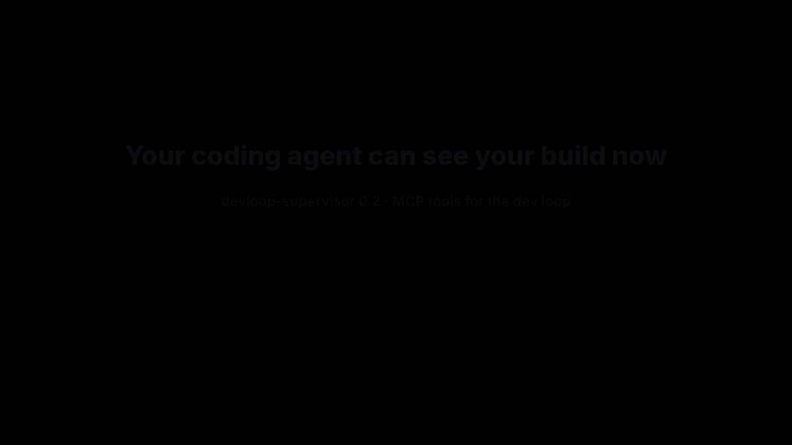

# devloop-supervisor

[](https://www.npmjs.com/package/devloop-supervisor)
[](https://nodejs.org)
[](LICENSE)
[](https://www.npmjs.com/package/devloop-supervisor)




Keeps your local dev loop alive. It runs your build watches and dev servers, **restarts whatever crashes**, shows live logs on a **status page**, and gives coding agents (Claude Code, Cursor, …) an **MCP endpoint** to read build errors and restart processes.

Zero dependencies. Node 18.18+. Windows, macOS and Linux.

```bash
npx devloop-supervisor init      # writes devloop.config.json
npx devloop-supervisor           # status page on http://localhost:4290
```

Or add it to a project: `npm install --save-dev devloop-supervisor`, then run `npx devloop-supervisor` or add `"dev": "devloop-supervisor"` to your scripts.

---

## Why

A watch (`ng build --watch`, `tsc --watch`, …) survives a compile error, but not a **crash**: the Node heap running out on a large build, its output folder deleted by a concurrent build, a locked file on Windows. Nothing restarts it, and you find out when the app stops picking up your changes.

devloop-supervisor:

- **builds before it serves**: watches start in order, and each waits for its first build, so the dev server never reads half-written output;
- **restarts what dies**, with backoff, and **pauses a crash loop** until your next save instead of spinning;
- can give the processes a **larger Node heap**;
- **warns about competing processes**, e.g. a second watch fighting over the same output folder;
- **rebuilds stale outputs** you aren't watching, before starting;
- writes **one log file per process**;
- serves a **status page** with live logs and Watch / Build once / Restart / Stop controls, plus desktop notifications on failure;
- exposes it all over **MCP**, so an agent can edit code, wait for the rebuild, and read the errors itself.

---

## Configuration

`devloop.config.json` (found in the current folder or any parent folder):

```json
{
  "name": "My dev loop",
  "prepare": "npm install",
  "processes": [
    {
      "id": "types",
      "kind": "watch",
      "command": "npx tsc --watch --preserveWatchOutput -p packages/shared",
      "preset": "tsc-watch",
      "sources": "packages/shared/src",
      "output": "packages/shared/dist",
      "buildOnce": "npx tsc -p packages/shared"
    },
    {
      "id": "web",
      "kind": "serve",
      "command": "npm run dev",
      "cwd": "apps/web",
      "preset": "vite",
      "port": 5173
    }
  ]
}
```

Processes start in the order listed. More in [`examples/`](examples/).

### Top level

| Key | Default | Meaning |
|---|---|---|
| `name` | `"Dev loop"` | Title on the status page |
| `port` | `4290` | Status page, API and MCP port (bound to 127.0.0.1) |
| `logDir` | `.devloop/logs` | One log file per process |
| `heapMb` | none | Sets `--max-old-space-size` for every process (via `NODE_OPTIONS`) |
| `prepare` | none | Command (or `{ "command", "cwd", "env" }`) run before anything starts |
| `crashLimit` | `5` | Quick crashes in a row before pausing |
| `quickExitMs` | `60000` | An exit sooner than this after start counts as a quick crash |
| `firstBuildTimeoutMs` | `1800000` | Longest wait for a process's first build before starting the next |
| `conflictPattern` | none | Regex over running processes' command lines; matches are shown as warnings |
| `freshMarker` | none | File written once every tracked output is newer than its sources |
| `errorPattern`, `warnPattern` | built in | Regexes that colour log lines and feed `get_errors` |
| `urlPattern` | `Local:\s+(https?://\S+)` | Picks the dev server's URL out of its output |

### Each process

| Key | Default | Meaning |
|---|---|---|
| `id` | required | Letters, digits, `-`, `_` |
| `kind` | required | `watch` (a build watch) or `serve` (a dev server) |
| `command` | required | Run through the shell, as written |
| `label` | `id` | Display name |
| `cwd` | config folder | Working folder |
| `env` | `{}` | Extra environment variables |
| `autostart` | `true` | Start it at launch (`--only` overrides) |
| `waitForReady` | `true` for `watch` | Wait for its first build before starting the next process |
| `preset` | `none` | Readiness patterns: `angular-library`, `angular-app`, `vite`, `tsc-watch`, `none` |
| `signals` | from preset | `{ "building": [...], "ready": [...], "error": [...] }` regexes; replace the preset per state |
| `port` | none | If busy, wait and retry instead of crashing |
| `buildOnce` | none | One-off build command (enables "Build once" and stale rebuilds) |
| `sources`, `output` | none | Folders compared by modification time to detect a stale build |
| `watchPaths` | `[sources]` | After a crash loop, a save here restarts the process |

A process with no `ready` signals counts as ready as soon as it starts.

---

## Command line

```
devloop-supervisor [init | mcp] [options]

  --config <file>     config file (default: nearest devloop.config.json)
  --only <a,b>        start only these processes
  --port <n>          override the port
  --heap <mb>         override heapMb
  --skip-prepare      skip prepare and stale-output builds
  --detach            run in the background
  --open              open the status page
  --stop              stop the running supervisor
  --status            print its status
```

Options also accept `key=value` (`only=web port=4300 detach=1`), which suits Makefiles.

---

## For coding agents (MCP)

The supervisor speaks the [Model Context Protocol](https://modelcontextprotocol.io), in two ways:

**stdio** (works with any MCP client). The `mcp` command connects to the supervisor running for this project:

```bash
claude mcp add devloop -- npx devloop-supervisor mcp
```

Or in a client's JSON config:

```json
{ "mcpServers": { "devloop": { "command": "npx", "args": ["devloop-supervisor", "mcp"] } } }
```

**HTTP** (no extra process), at `http://127.0.0.1:4290/mcp`:

```bash
claude mcp add --transport http devloop http://127.0.0.1:4290/mcp
```

### Tools

| Tool | What it does |
|---|---|
| `get_status` | Every process: state, last build result, restarts, dev server URL |
| `get_errors` | Recent error lines, from all processes or one |
| `get_logs` | Recent output of one process (optionally errors only) |
| `wait_for_builds` | Waits until nothing is building, then returns status and errors |
| `restart_process` | Restarts a process (also clears a crash-loop pause) |
| `start_process` / `stop_process` | Starts or stops a process |
| `build_once` | One-off build of a stopped watch |

A typical agent loop: edit files → `wait_for_builds` → fix whatever `get_errors` reports → repeat.

---

## Security

- The server listens on **127.0.0.1 only** and refuses requests whose `Host` isn't `127.0.0.1` or `localhost` (blocks DNS rebinding).
- State-changing API calls need an `X-Devloop` header, which forces a CORS preflight that is never granted.
- `/mcp` accepts only `application/json` bodies and rejects non-local `Origin`s.
- Commands come only from your config file; nothing received over HTTP or MCP is ever run as a command.

---

## Development

```bash
npm test
```

The tests start a real supervisor over fake build and serve processes and drive it through the HTTP API, the HTTP MCP endpoint and the stdio MCP server.

## License

MIT
